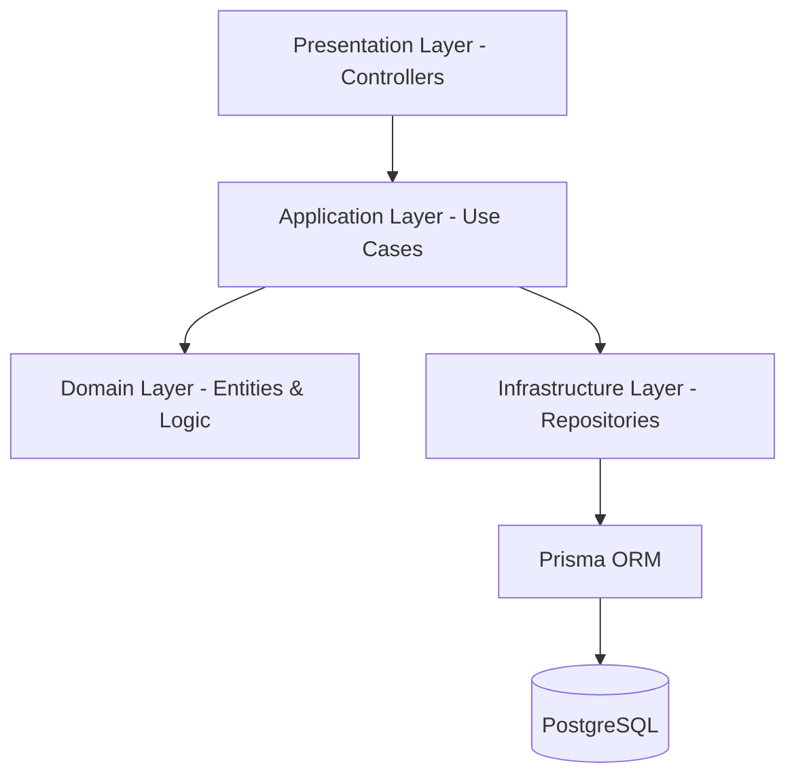

# Enterprise CRM & Tasks Platform - Backend


[](https://github.com/qurban7860/NestJS-Angular-Enterprise-CRM-SaaS-Platform/actions/workflows/backend-ci.yml)

An enterprise-style, multi-tenant backend built with **NestJS**, following clean architecture principles and domain-driven design patterns.

## 🚀 Key Features

- **Multi-tenant Architecture**: Organization-scoped business data.
- **Enterprise Security**: JWT-based authentication with Role-Based Access Control (RBAC).
- **Domain Driven Design (DDD)**: Logic organized into Use Cases, Repositories, and Domain Entities.
- **Task Management**: Full task lifecycle, status transitions, comments, and assignee management.
- **CRM Suite**: Lead tracking, Contact management, and Deal pipeline (Kanban support).
- **Stripe Integration**: Secure webhook processing with idempotency for automated plan upgrades and subscription lifecycle management.
- **Real-Time WebSockets**: Unified `NotificationsGateway` and `BroadcastGateway` for instant client synchronization, task alerts, and system announcements.
- **Premium Features Module**:
  - Advanced RBAC (`PermissionsGuard`, `RequirePermissions`).
  - Event-driven Automated Workflows executing business rules.
  - Data aggregation and generation for Custom Reports.
- **File Management**: Integrated file upload and attachment system.
- **Automated Documentation**: Full Swagger/OpenAPI integration.

## 🏗️ Architecture

The backend follows a layered architecture to keep presentation, application, domain, and infrastructure concerns separated:



## 🛠️ Tech Stack

- **Framework**: [NestJS](https://nestjs.com/)
- **Database**: [PostgreSQL](https://www.postgresql.org/)
- **ORM**: [Prisma](https://www.prisma.io/)
- **Validation**: [class-validator](https://github.com/typestack/class-validator)
- **Security**: Passport.js + JWT
- **Documentation**: Swagger / OpenAPI

## 🏁 Getting Started

### Prerequisites

- Node.js 24
- PostgreSQL instance

### Installation

1. Install dependencies:
   ```bash
   npm ci
   ```

2. Configure environment variables:
   Create a `.env` file based on `.env.example`. Supply the database connection values and authentication secrets required by your local setup. Never commit real secrets.

3. Apply database migrations:
   ```bash
   npx prisma migrate dev
   ```

4. Run the application:
   ```bash
   # Development
   npm run start:dev

   # Production build
   npm run build
   npm run start:prod
   ```

## 📖 API Documentation

When the application is running outside production mode, the Swagger UI is available at:

`http://localhost:3000/api/docs`

## 🧪 Testing

```bash
# Non-mutating TypeScript source lint
npm run lint:check

# Unit tests
npm test -- --runInBand

# End-to-end smoke tests (requires configured application dependencies)
npm run test:e2e
```

The end-to-end smoke test boots the full `AppModule`, so configure the database and supporting services before running it.

## 🔁 Continuous Integration

The **Backend CI** workflow runs for pushes and pull requests targeting `main` when backend files or the workflow itself change. It performs a clean install from `package-lock.json`, builds the NestJS backend, runs the backend unit tests, and executes `npm run lint:check`.

The `lint:check` script checks TypeScript files under `src/` without modifying them. The existing `npm run lint` script is auto-fixing and should not be used as a CI validation command. Infrastructure-dependent end-to-end tests remain separate until their database and supporting-service requirements are provisioned. See [`docs/ROADMAP.md`](../../docs/ROADMAP.md) for verification status and remaining work.

## 📜 License

No `LICENSE` file is currently included in this repository, so reuse terms have not been explicitly granted.
